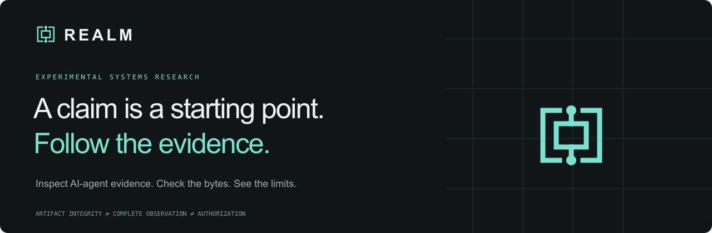
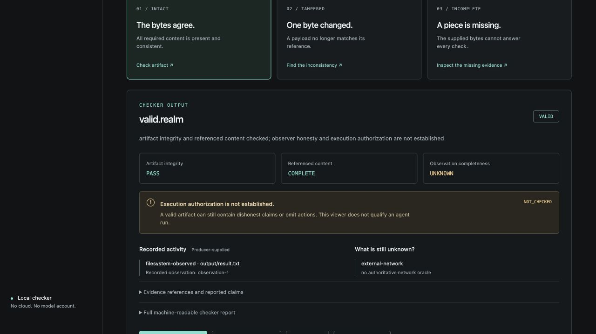

# REALM Artifact Toolkit · v0.1 preview

**An AI agent says “done.” What can you actually check?**

REALM checks recorded evidence and makes its limits visible. An intact artifact
can contain an incomplete story. This toolkit lets you inspect that distinction
locally, using the existing Rust verifier and a visual Proof Viewer.

This candidate is licensed for redistribution under **MIT OR Apache-2.0** for
original project material, with separately retained dependency notices. It is
still private pending publication approval. No account, AI model or VM is needed.

## Start with the counterexample

Requirements: Python 3.10+, Rust/Cargo 1.97.1 and a C compiler on macOS or Linux.
From an extracted source archive or checkout:

```sh
./realm example
```

Two real workers repair the same tiny arithmetic program. Both pass the task
test. One also changes a file forbidden by the example's policy, then restores
it. An independent harness reopens the changed file during a cooperative pause.
The supplied before/after files and empty logs leave that action out.

```text
History   Task test   Protected-file transient   Artifact   Execution
clean     PASS        none in designed worker   VALID      INCOMPLETE
hidden    PASS        independently reopened    VALID      INCOMPLETE
Artifacts byte-identical: True
```

The checker validates the supplied records. **It does not detect the omitted
runtime-policy violation or establish complete execution.** The harness sees
one designed effect; it is not an exhaustive observer or a containment boundary.
[Read the full case study](docs/COUNTEREXAMPLE.md), then inspect
`realm-counterexample/result.json`, each worker's files and the actual checker
reports. Use `./realm example --output NEW_DIRECTORY` to repeat without overwriting.

## Explore the Proof Viewer

```sh
./realm playground
```

Open the printed loopback URL. Try intact, tampered and incomplete samples;
flip a byte; inspect activity and unknowns; download the checker JSON. To inspect
the counterexample, choose **Load your .realm artifact** and open
`realm-counterexample/hidden/observed.realm`. The Rust executable does the checks.
Uploads stay on your machine and are deleted after checking.



## Use the checker directly

```sh
./realm demo
./realm inspect realm-demo/valid.realm --json
./realm verify realm-demo/tampered.realm --json
./realm verify realm-demo/valid.realm --require-execution --json
```

The last two commands intentionally return exits **1 (INVALID)** and
**3 (INCOMPLETE)**. Other statuses are VALID (0), usage error (2), UNSUPPORTED (4),
and IO_ERROR (5). An intact artifact is not evidence of observer honesty, task
correctness, complete observation or execution authorization.

To package your own caller-supplied observation:

```sh
./realm record run-001 before.txt after.txt supplied.log observed.realm
```

This importer neither executes nor contains an agent. See the
[format and JSON contract](docs/ARTIFACT_FORMAT.md).

## Reproduce the finite benchmarks

```sh
./realm bench --output realm-bench-fresh
./realm baseline --output realm-baseline-fresh
```

A has **18 variants of one fixture ×5 repetitions**, not 90 independent cases.
B has **7 finite mechanisms ×4 related arithmetic seeds ×3 repetitions**.
All 60 planted policy violations pass task tests. Supplied logs/snapshots flag 36;
REALM detects **zero** as runtime-policy violations, and all 84 authorization
requests remain INCOMPLETE. [Methods, baselines and limits](benchmarks/README.md).
Fresh runs retain all artifacts, outcomes, failed probes and source/binary hashes.
This compact release includes the 18 frozen A inputs, not hundreds of duplicate
measurement outputs. They are generated again when you run the experiments.

## Install, license and scope

[Installation and unsigned-binary limits](INSTALL.md) · [Licensing and notices](RIGHTS.md) ·
[Security scope](SECURITY.md) · [Contributing](CONTRIBUTING.md) ·
[Export provenance](PROVENANCE.json) · [Exact file manifest](EXPORT_MANIFEST.json)

Locked source builds remain the reference path. A separately prepared macOS ARM64
binary preview includes the same source/viewer/notices and checks its executable
checksum; the checksum is not publisher authentication. It is unsigned and not
notarized; downloaded-file Gatekeeper behavior is untested. Source-only evaluation
does not require notarization. Never bypass platform security controls.

Supported release scope: artifact inspection, observation import and reproducible
controlled demonstrations. V6 library modules remain only as the existing
verifier's compile dependencies; they are not supported execution guarantees.
Experimental production CLI entry points, V7 runtime work, private history,
external benchmark datasets, model weights and VM images are excluded.
Development used AI coding assistants. Do not describe this work as entirely
human-generated. See [the release contents](docs/CONTENTS.md).
