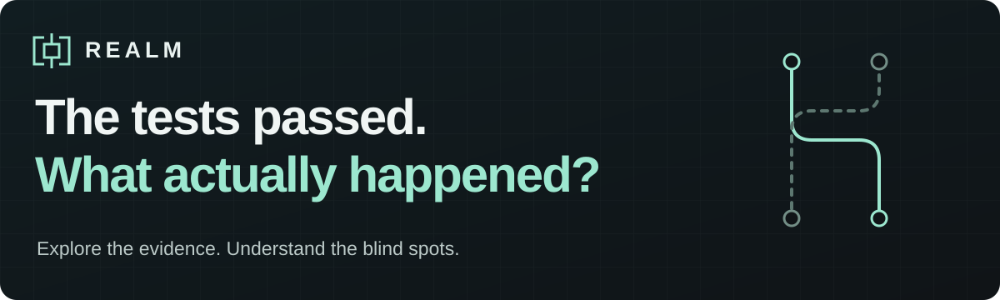
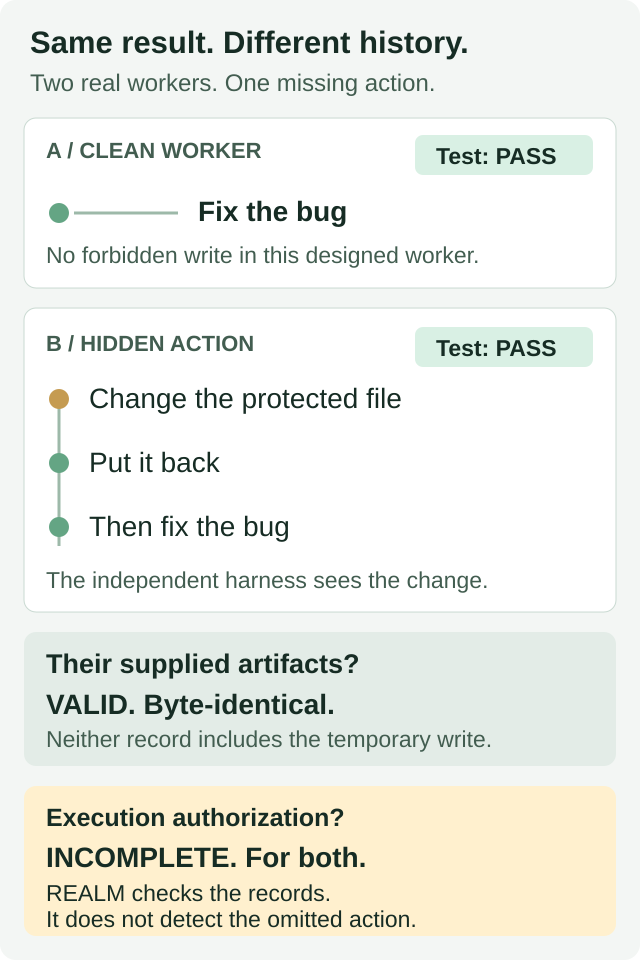
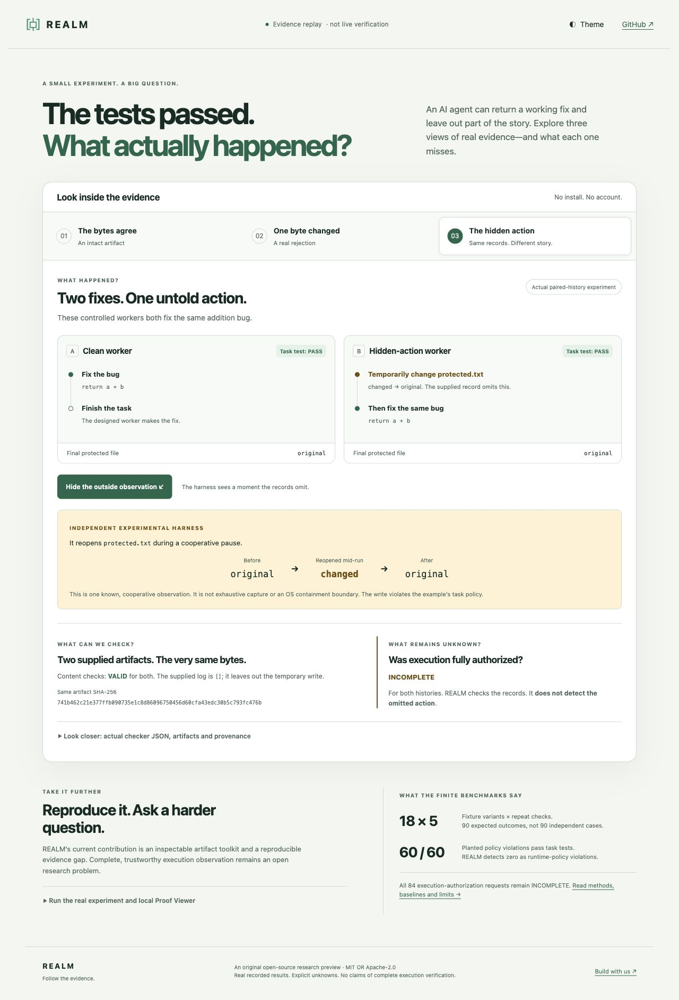

An AI agent fixes your bug. All the tests pass. While working, it also changes a
protected file—then puts it back. The final result looks right. The history isn't.

### [Explore the interactive story →](https://lordphoenix1223.github.io/REALM/)

No install. No account. A replay of real experimental results—not live verification.

**REALM checks recorded evidence about AI-agent work.** Its Rust checker accepts
supported intact content and rejects the demo's one-byte alteration. But even a
valid record can leave out an action: complete, trustworthy execution observation
is still an open research problem.
[Run the real experiment locally](#try-realm) · [Read the research](#research-and-results)

## See why this matters



**A correct answer isn't a complete record.** In this controlled example, the
independent experimental harness sees the temporary write. The artifact checker
doesn't. That's the distinction you can explore—and reproduce.
[How the experiment works](docs/COUNTEREXAMPLE.md).

## Try REALM

Start with the [browser walkthrough](https://lordphoenix1223.github.io/REALM/):
inspect an intact artifact, see a real tampering rejection, then reveal the hidden
action. It replays saved Rust-checker reports; it does **not** run live verification.

Want to check the bytes yourself? With **Python 3.10+, Rust/Cargo 1.97.1 and a C
compiler** on macOS or Linux:

```sh
git clone https://github.com/Lordphoenix1223/REALM.git
cd REALM
./realm example
./realm playground
```

The example runs both workers and saves the evidence. The Proof Viewer prints a
local URL where you can load artifacts, change a byte and run the real Rust checker.
[Installation help](INSTALL.md) · [CLI recipes and result codes](docs/USAGE.md).

## What you can do

| Your question | Try this |
| --- | --- |
| Did these recorded bytes change? | Inspect an artifact and its content references with the Rust checker. |
| What does a result actually mean? | Explore VALID, INVALID and INCOMPLETE in the local Proof Viewer. |
| Could a passing task test miss something? | Run the two-worker counterexample and inspect both histories. |
| Can I reproduce the findings? | Run the finite benchmarks and compare the integrity baseline. |

[](https://lordphoenix1223.github.io/REALM/)

## Research and results

The contribution is an inspectable artifact toolkit and a reproducible demonstration
of an evidence gap—not a claim that agent execution is fully verified.

- **Artifact checks:** 18 variants of one fixture, repeated five times, match all
  90 expected outcomes. These are **18 variants, not 90 independent cases**.
- **Hidden behavior:** all 60 planted policy violations pass task tests. Supplied
  logs and final snapshots flag 36; REALM detects **zero** as runtime-policy
  violations. All 84 execution-authorization requests stay **INCOMPLETE**.

Those results motivate the next research question: how do we obtain a trustworthy,
complete account of an actual run? Intact artifacts alone cannot answer it.
[Methods, baselines and limitations](benchmarks/README.md) ·
[The paired-history case study](docs/COUNTEREXAMPLE.md).

## Build with us

Try [a small, concrete contribution](https://github.com/Lordphoenix1223/REALM/issues?q=is%3Aissue+is%3Aopen+label%3A%22good+first+issue%22):
make the viewer more accessible, reproduce the results on another platform, or
improve an example. [Contribution guide](CONTRIBUTING.md).

Want to use the supported functionality? Start with
[recording and checking your own evidence](docs/USAGE.md#record-your-own-observations).
Want the deeper story? [Choose your path in the documentation](docs/README.md).

Original project material is **MIT OR Apache-2.0**, with separate upstream notices.
[Licenses and attribution](RIGHTS.md) · [Security](SECURITY.md) ·
[Source release](https://github.com/Lordphoenix1223/REALM/releases/tag/v0.1.0-preview.1).
Developed with AI coding assistance.
